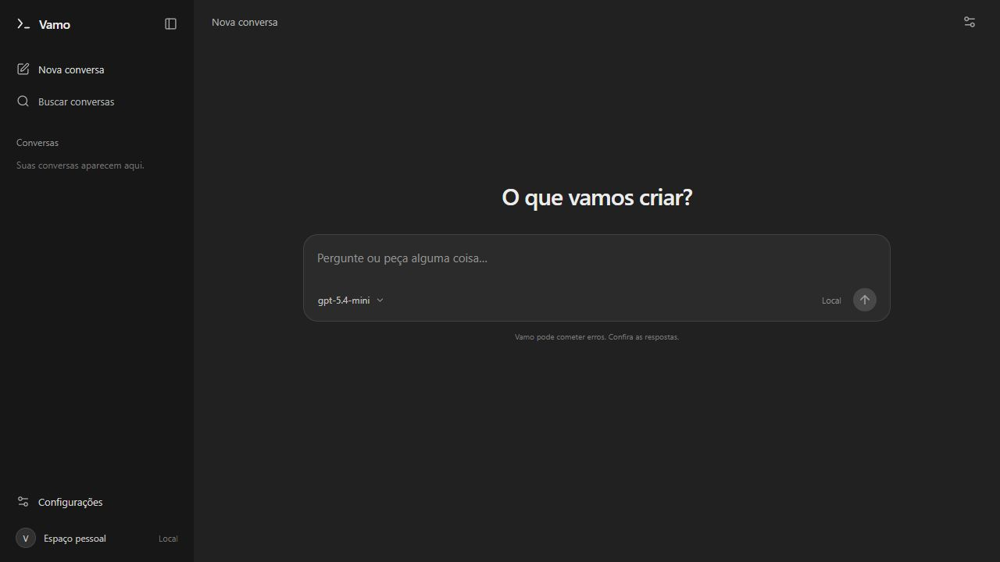

# vamo! chatbot with Go, React, and OpenAI

A local chat application in Brazilian Portuguese. The backend uses only the Go standard library; the frontend uses React, TypeScript, and Vite.



## Features

- Streaming responses through the OpenAI Responses API.
- Conversation context sent with each message, with a button to stop generation.
- Markdown, tables, and code blocks in responses.
- Local history with search, deletion, and Markdown export.
- Minimal dark interface with a collapsible sidebar, responsive layout, and connection settings.
- Handling for missing API keys, usage limits, unavailable models, failures, and incomplete responses.

## Getting started on Windows

The delivered ZIP package includes the built frontend and `backend/vamo-chat.exe` for Windows x64. You do not need Go or Node to run that version. These build artifacts are not tracked in Git; after cloning the repository, follow the development instructions or build the application before running `iniciar.cmd`.

1. Copy `backend/.env.example` to `backend/.env`.
2. Set `OPENAI_API_KEY` in that file using a key from your account: [manage API keys](https://platform.openai.com/api-keys).
3. Run `iniciar.cmd` and keep the terminal open.
4. Open <http://127.0.0.1:8080>.

The default model is `gpt-5.4-mini`. You can set `OPENAI_MODEL` to a Responses-compatible model available to your account. The API requires your own API key and balance. Without a key, the interface opens and explains how to configure it; no responses are simulated.

## Developing from source

Requirements: Go 1.23 or later; Node 22.12 or later (or 20.19+), with npm. Use a currently supported Go version for new installations.

In the first terminal, from the `backend` directory:

```powershell
Copy-Item .env.example .env
# Edit .env and add your API key. Do not put it in the frontend.
go run .
```

In the second terminal, from the `frontend` directory:

```powershell
npm ci
npm run dev
```

Open <http://127.0.0.1:5173>. Vite forwards `/api` requests to Go on port 8080. If you change the backend port, also update `frontend/vite.config.ts`.

## Building a new version

From the `frontend` directory:

```powershell
npm ci
npm run build
```

From the `backend` directory:

```powershell
go build -trimpath -o vamo-chat.exe .
```

Go serves the files in `frontend/dist` and the API at the same address. Start the application from the `backend` directory, as `iniciar.cmd` does. On Linux/macOS, build with `go build -o vamo-chat .` and run `./vamo-chat` from that directory.

## Backend configuration

| Variable | Default | Purpose |
| --- | --- | --- |
| `OPENAI_API_KEY` | empty | OpenAI API key, kept on the server only |
| `OPENAI_MODEL` | `gpt-5.4-mini` | Model used for generation |
| `HOST` | `127.0.0.1` | Local network interface |
| `PORT` | `8080` | HTTP port |
| `ALLOWED_ORIGINS` | `http://localhost:5173,http://127.0.0.1:5173` | Additional allowed origins, separated by commas |
| `FRONTEND_DIST` | `../frontend/dist` | Path to the built frontend files |

The `.env` file is read at startup. Existing environment variables take precedence. Restart the server after changing the API key or model.

## API

`GET /api/health` reports whether the server is running, the configured model, and whether an API key has been set. It does not make a paid request or confirm that the key is valid.

`POST /api/chat`, with `Content-Type: application/json`:

```json
{
  "messages": [
    { "role": "user", "content": "Help me organize an idea." }
  ]
}
```

A successful request returns SSE:

```text
data: {"type":"delta","delta":"Let's get started!"}

data: {"type":"done"}

```

Errors before streaming return HTTP 4xx/5xx with `{"error":"message"}`. Errors during generation return a `{"type":"error","error":"message"}` event. A response is considered complete only after `done`. Canceling in the browser also cancels the request to OpenAI.

Limits: up to 100 messages per request; 16,000 characters per message; 120,000 bytes of conversation content; a 256 KiB HTTP request body; and up to 4,096 output tokens. Start a new conversation when you reach a limit. The frontend does not silently discard the beginning of a conversation to fit the context.

## Data and scope

History is stored in this browser's `localStorage`, with a limit of 30 conversations. There is no synchronization or database. When a new conversation exceeds that limit, the oldest conversation in the list is removed; export anything you want to keep. Deleting a conversation removes its local history.

Messages and conversation context are sent to OpenAI when you submit a question. The integration uses `store: false`; this does not replace the API's data retention policies. The API key stays in the backend, and `.env` files are ignored by Git. Do not share your key or add it to `VITE_*` variables.

This starter application is intended for local use and has no authentication. Before exposing the server to the internet, add authentication, per-user limits, and HTTPS. The Go backend requires hosting that supports Go applications or containers.

## Verification

```powershell
# From backend
go test -v ./...
go vet ./...

# From frontend
npm test
npm run build
```

The backend tests use a mock OpenAI server to verify the HTTP contract, conversation context, streaming, errors, cancellation, and API key protection. The frontend tests verify the SSE parser, including UTF-8 text split across network chunks. You do not need an API key to run the tests.

## Project structure

```text
backend/
  main.go             # HTTP server, OpenAI client, configuration, and streaming
  main_test.go        # Local integration tests
  .env.example        # Configuration without secrets
  vamo-chat.exe       # Compiled executable for Windows x64
frontend/
  src/App.tsx         # Interface and conversation flow
  src/api.ts          # Local API client
  src/lib/sse.mjs     # Incremental event parser
  src/storage.ts      # Browser history
  src/styles.css      # Responsive layout
  tests/              # Parser tests
  dist/               # Built frontend
iniciar.cmd           # Starts the built Windows version
```

References: [Responses and streaming](https://developers.openai.com/api/docs/guides/streaming-responses), [configured model](https://developers.openai.com/api/docs/models/gpt-5.4-mini), [React](https://react.dev/reference/react-dom/client/createRoot), and [Vite](https://vite.dev/guide/).
